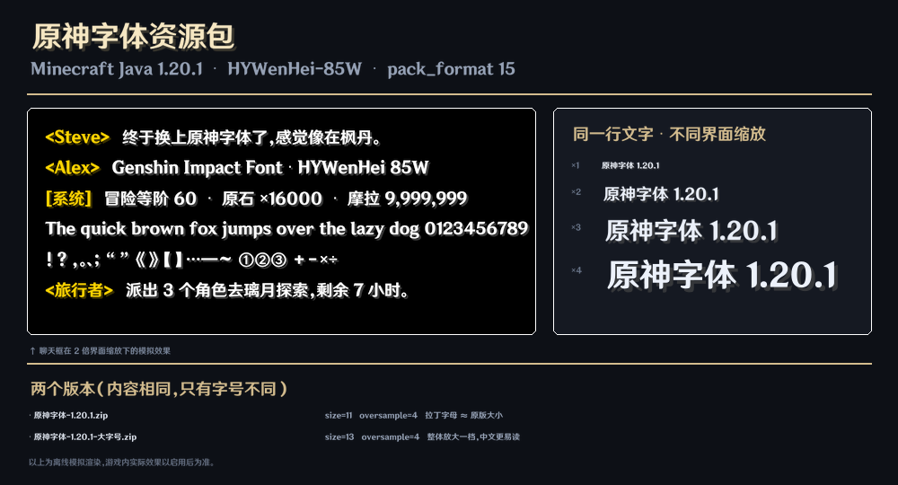

# 原神字体资源包 · Minecraft Java 1.20.1

把《原神》界面字体 **HYWenHei-85W（汉仪文黑 Heavy）** 换进 Minecraft。中英文、数字、符号、
聊天、告示牌、书本、F3 界面全部生效，字体文件已经打包在资源包里，装上即可用。

| 文件 | 说明 |
| --- | --- |
| `原神字体-1.20.1.zip` | **标准版**（`size=11`）。拉丁字母大小和原版几乎一致，中文会明显比原版紧凑，行距不再互相压字。推荐先装这个。 |
| `原神字体-1.20.1-大字号.zip` | **大字号版**（`size=13`）。整体放大一档，中文更好认；部分界面会比原版占宽一点。 |
| `预览.png` | 模拟效果图（见下） |
| `pack.png` | 资源包图标 |



> 预览图是离线模拟渲染（按游戏 2 倍界面缩放的采样方式画的），真实效果请以游戏内为准。

---

## 安装

1. 把 zip **直接**丢进 `.minecraft/resourcepacks`（别解压）。
   - 找不到文件夹：游戏里 `选项 → 资源包 → 打开资源包文件夹`。
   - 用 PCL / HMCL / Prism 等启动器也可以直接把 zip 拖进"资源包"页。
2. 游戏内 `选项 → 资源包`，把「原神字体」从左侧移到右侧已启用列表，点"完成"。
3. 如果文字没变化：`选项 → 语言` 里确认 **关闭「强制使用 Unicode 字体」**（这个选项会绕过资源包字体）。

## 版本兼容

`pack.mcmeta` 里写的是 `pack_format: 15`，对应 **1.20 / 1.20.1**。
其它版本只要改这一个数字就能用（字体系统的写法在 1.20.2 之后才变动，以下版本均已实测可用同结构）：

| 游戏版本 | pack_format |
| --- | --- |
| 1.19.4 | 12 |
| 1.20 – 1.20.1 | **15** |
| 1.20.2 | 18 |
| 1.20.3 – 1.20.4 | 22 |
| 1.20.5 – 1.20.6 | 32 |
| 1.21 – 1.21.1 | 34 |

改法：解压 → 用记事本改 `pack.mcmeta` 里的数字 → 重新压成 zip（`pack.mcmeta` 必须在压缩包根目录）。

## 想调整字号 / 位置

打开包里的 `assets/minecraft/font/default.json`：

```json
{
  "providers": [
    { "type": "reference", "id": "minecraft:include/space" },
    { "type": "ttf", "file": "minecraft:font/hywenhei85w.ttf",
      "size": 11, "oversample": 4, "shift": [0, 0.5], "skip": "..." },
    { "type": "reference", "id": "minecraft:include/default" },
    { "type": "reference", "id": "minecraft:include/unifont" }
  ]
}
```

| 字段 | 作用 | 建议 |
| --- | --- | --- |
| `size` | 字号。游戏把字体里"上伸+下伸"共 1.22 em 的高度映射成这么多像素 | 10 更小 / 11 标准 / 12 稍大 / 13 大字号 / 14 很大 |
| `oversample` | 抗锯齿采样倍率，越大边缘越平滑、越占显存 | 2–6，4 够用；低配机器改 2 |
| `shift` | 整体位移，`[左右, 上下]`，正数分别向左/下 | 只微调第二个数字，±1 就够明显 |
| `skip` | 让这些字符**不走**这个字体（回退到原版） | 默认已排除希腊字母，见下 |

改完注意：**不要把 `size` 调得太大**，部分模组界面是硬编码像素宽度，超过 14 容易溢出。

## 为什么要留两条 `reference`

资源包的 `default.json` 是**整个**默认字体定义，覆盖后必须自己把原版的兜底链补回来，否则字体文件里没有的字符会变成"豆腐块"□：

1. `minecraft:include/space` —— 原版的空格宽度（4 px）和零宽字符，保证排版正常；
2. `ttf` —— 原神字体本体；
3. `minecraft:include/default` —— 原版 Mojangles 位图字体，只在 TTF 里没有对应字符时兜底；
4. `minecraft:include/unifont` —— GNU Unifont，兜底生僻字（CJK 扩展 A、B 等）。

## 已知限制

- **希腊字母**：社区流传的这份 `HYWenHei-85W` 字体文件（"Genshin-Impact" 重制版）在 U+0370–U+03FF
  区段里是错乱的（α 会画成乌克兰语字母 Ï 之类的形状）。本包已把希腊字母加进 `skip`，让它回退到原版
  字体，至少能认出是什么字；因此希腊语玩家的界面会变成像素字。
- **拉丁扩展 A / B**（`Ā Ń Š Ž ș ț` 等）这份字体文件里没有，会回退到 Unifont 显示，字形是像素风、
  比周围文字略大略粗。捷克语、波兰语、越南语等会看到这个现象。
- **全角英数**（`ＡＢＣ１２３`）字体里映射成半角字形，会比预期窄。
- 只改变量字体外观，**不影响**带图的图标（心/饥饿/经验条那些不是字体）。

## 授权与致谢

- 字体版权归 **汉仪字库 / 米哈游** 所有，本资源包仅供**个人在游戏内使用**，请勿商用或二次分发。
- 字体文件取自开源项目 [HYWenHei-Extended-Font](https://github.com/cawa-93/HYWenHei-Extended-Font)
  （MIT License, © 2024 Alex Kozack），它本身是对《原神》字体的扩展重制。
- 参数（`size` / `oversample` / `shift`）参考了社区通行配置，并在此基础上补全了兜底字体链与希腊字母排除。
